# Dia-Assistent für Immich

Eine **seniorengerechte, geführte Oberfläche**, mit der sich gescannte Dias (oder andere Fotos) in
[Immich](https://immich.app) nachträglich beschriften lassen: Datum, Ort, Beschreibung, Personen und Themen.
Eine Frage pro Bildschirm, große Schrift, große Knöpfe, kein Fachjargon.

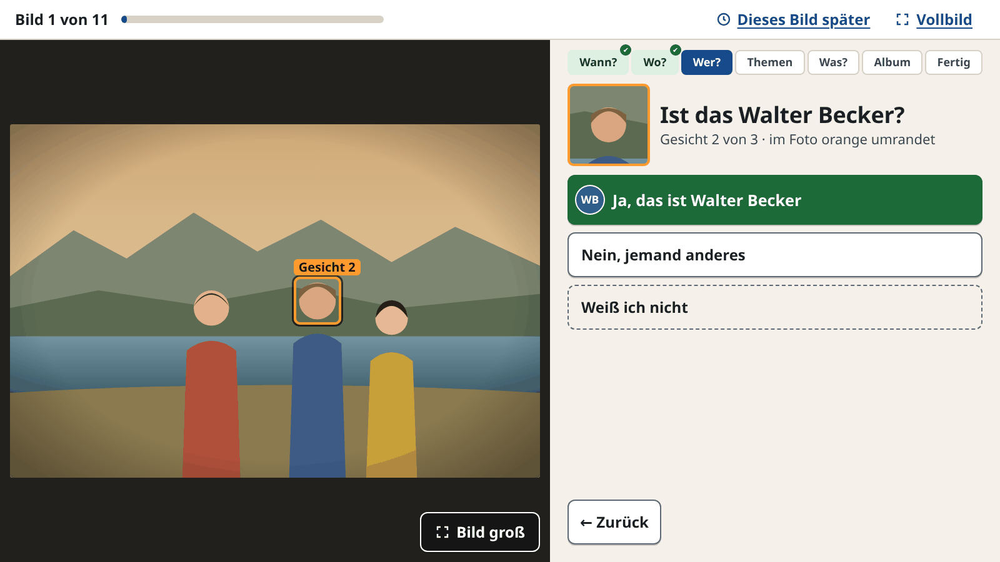

*German-language tool: a simple, guided UI for elderly users to add date, place, description, people and
tags to photos in Immich. Runs locally and talks to Immich via its REST API.*

> [!WARNING]
> **Dieses Projekt ist zu 100 % „vibe-coded“.**
> Der gesamte Code, die Tests und diese Dokumentation wurden von einer KI ([Claude Code](https://claude.com/claude-code))
> geschrieben. Der Maintainer hat die Anforderungen vorgegeben und das Ergebnis ausprobiert, den Code
> aber **nicht Zeile für Zeile geprüft**.
>
> - Das Programm **schreibt in deine Immich-Bibliothek** (Datum, Ort, Beschreibung, Tags, Gesichter).
>   **Mach vorher ein Backup** und probiere es zuerst mit wenigen Bildern aus.
> - Es gibt **keine Gewährleistung** (siehe [Lizenz](#lizenz)) und keinen Support. Nutzung auf eigenes Risiko.
> - Kein offizielles Immich-Projekt und nicht mit Immich verbunden.
> - Gebaut gegen **Immich v3.3.1**. Andere Versionen können sich anders verhalten.

---

## Inhalt

- [Funktionen](#funktionen)
- [Installation](#installation)
- [Einrichtung](#einrichtung)
- [Bedienung](#bedienung) – mit Bildern zu jedem Schritt
- [Was genau gespeichert wird](#was-genau-gespeichert-wird)
- [Update und Fehlersuche](#update-und-fehlersuche)
- [Bekannte Grenzen](#bekannte-grenzen)
- [Technische Details](#technische-details)
- [Entwicklung](#entwicklung)
- [Lizenz](#lizenz)

---

## Funktionen

- Arbeitet eine Liste ab: alle Bilder mit dem Tag `Dia-Nachpflege` (Name einstellbar), eins nach dem anderen.
- Sechs kurze Fragen pro Bild, jede überspringbar:
  **Wann?** · **Wo?** · **Wer ist darauf?** · **Welche Themen?** · **Was ist zu sehen?** · **Welches Album?**
  Reihenfolge und Auswahl lassen sich in der Oberfläche einstellen.
- Datum auch ungefähr („Irgendwann in den 60ern“, nur das Jahr, „Nur ungefähr“).
- Ortssuche über OpenStreetMap; der Ort wird zusätzlich als Tag `Kontinent/Land/Ort` gespeichert.
- Jedes von Immich erkannte Gesicht wird einzeln abgefragt, auch schon zugeordnete („Ist das …?“).
  Weitere Personen ohne erkanntes Gesicht lassen sich dazuwählen oder neu anlegen.
- Themen (Immich-Tags) mit Unterthemen, Suche und Anlegen neuer Themen samt Überthema; Alben auswählen oder neu anlegen.
- Gestaltung für ältere Menschen: warmer Papierton statt grellem Weiß, hoher Kontrast, Lesetext mindestens 19 px
  (nur die Schrittleiste ist kleiner), Antwortknöpfe mindestens 56 px hoch. „← Zurück“, „Weiß ich nicht“ und „Weiter →“ stehen immer an derselben Stelle.
  Bedienbar mit Maus, Tastatur oder Touch, ab 1024 × 600 Bildpunkten.
- Speichert nur, was ausgefüllt wurde, und löscht nichts in Immich.
- Bearbeitete Bilder bekommen den Tag `Dia-bearbeitet`, damit sich der Fortschritt zählen lässt.
- Läuft lokal auf `127.0.0.1`. Der Immich-API-Schlüssel bleibt im lokalen Programm und gelangt nie in den Browser.

---

## Installation

Gedacht für **Zorin OS / Ubuntu** (ab 22.04), andere Linux-Systeme mit Python ≥ 3.10 und `venv` sollten auch gehen.

```bash
sudo apt install python3 python3-venv git
git clone https://github.com/John-Goodenough/Immich-Metadata-Editor.git ~/dia-assistent
cd ~/dia-assistent
./install.sh
```

Statt `git clone` geht auch der Quellcode einer Version aus den
[Releases](https://github.com/John-Goodenough/Immich-Metadata-Editor/releases): entpacken und dort `./install.sh` ausführen.

`install.sh`

- legt eine virtuelle Umgebung `.venv` an und installiert die Abhängigkeiten,
- kopiert `config.example` nach `.env` (falls noch nicht vorhanden),
- legt einen Starter **„Dia-Assistent“** im Startmenü und auf dem Schreibtisch an.

Ein Doppelklick auf den Starter startet das Programm und öffnet den Browser. Fragt Zorin beim ersten Mal nach:
Rechtsklick auf das Symbol → „Start erlauben“.

---

## Einrichtung

### 1. Bilder in Immich markieren

In Immich die zu bearbeitenden Bilder auswählen und per Mehrfachauswahl den Tag **`Dia-Nachpflege`** setzen.
Nur diese Bilder zeigt der Assistent an.

### 2. API-Schlüssel anlegen

In Immich unter *Kontoeinstellungen → API-Schlüssel → Neuer API-Schlüssel*. Der Schlüssel muss zu dem
Konto gehören, dem die Bilder gehören. Es reichen diese Rechte:

| Recht | Wofür |
|---|---|
| `asset.read` | Bilder mit Tag finden, Bilddaten lesen |
| `asset.view` | Vorschaubild anzeigen |
| `asset.update` | Datum, Ort, Beschreibung schreiben |
| `tag.read` | Tags auflisten |
| `tag.create` | neue Themen sowie `Datum-ungefähr` und `Dia-bearbeitet` anlegen |
| `tag.asset` | Tags an Bildern setzen und den Arbeits-Tag entfernen |
| `person.read` | Personen und ihre Gesichtsbilder anzeigen |
| `face.read` | prüfen, wer schon zugeordnet ist |
| `face.create` | Person ohne erkanntes Gesicht einem Bild zuordnen |
| `face.update` | erkanntes Gesicht einer Person zuordnen |
| `person.create` | neue Person anlegen |
| `album.read` | Alben auflisten |
| `album.create` | neues Album anlegen |
| `albumAsset.create` | Bild in ein Album legen |

### 3. `.env` ausfüllen

Die Datei `.env` im Programmordner öffnen und mindestens `IMMICH_URL` und `IMMICH_API_KEY` eintragen.
Die Datei wird nicht eingecheckt (`.gitignore`).

| Schlüssel | Standard | Bedeutung |
|---|---|---|
| `IMMICH_URL` | – | **Pflicht.** Adresse der Immich-Instanz, z. B. `https://immich.example.de` (ohne `/api`) |
| `IMMICH_API_KEY` | – | **Pflicht.** API-Schlüssel aus Schritt 2 |
| `TAG_NAME` | `Dia-Nachpflege` | Tag der zu bearbeitenden Bilder (bei verschachtelten Tags der volle Pfad) |
| `APPROX_TAG_NAME` | `Datum-ungefähr` | Tag für Bilder mit ungefährem Datum |
| `DONE_TAG_NAME` | `Dia-bearbeitet` | Tag für Bilder, die im Assistenten gespeichert wurden |
| `TIMEZONE` | `Europe/Berlin` | Zeitzone für das Datum |
| `YEAR_FROM` / `YEAR_TO` | `1940` / `2010` | Jahre, die zur Auswahl stehen |
| `NOMINATIM_CONTACT` | – | Kontakt-E-Mail für die Ortssuche, empfohlen laut [Nominatim-Nutzungsrichtlinie](https://operations.osmfoundation.org/policies/nominatim/) |
| `NOMINATIM_URL` | öffentliche Instanz | eigene Nominatim-Instanz |
| `PORT` | `8765` | lokaler Port |

**Immich hinter Reverse Proxy oder SSO (z. B. Authentik, Pangolin):** Der Assistent meldet sich nicht über
die Weboberfläche an, sondern schickt den API-Schlüssel direkt mit (`x-api-key`). Der Pfad
`https://<domain>/api/…` muss deshalb **ohne vorgeschaltete Anmeldeseite** erreichbar sein, so wie es auch die
Immich-Handy-App braucht.

---

## Bedienung

Die Bilder in diesem Abschnitt zeigen ein gezeichnetes Beispiel-Dia mit erfundenen Namen.

### Start

Starter doppelklicken. Der Browser zeigt, wie viele Bilder warten. **„Los geht's“** beginnt mit dem ersten Bild,
**„Fragen einstellen“** legt fest, welche Fragen in welcher Reihenfolge kommen, **„Vollbild“** schaltet den Browser
in den Vollbildmodus.

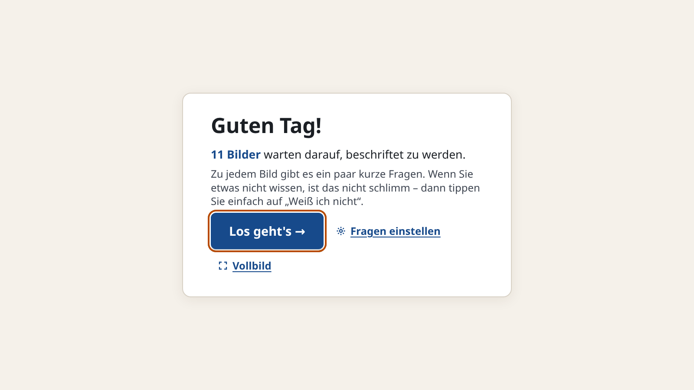

### Aufbau jeder Frage

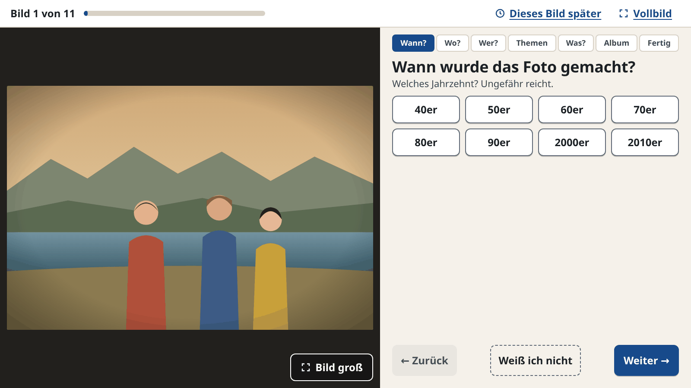

- **Oben:** Fortschritt („Bild 1 von 11“), **„Dieses Bild später“** (überspringt das Bild ohne zu speichern; es
  kommt beim nächsten Start wieder) und **„Vollbild“**.
- **Links:** das Dia. **„Bild groß“** zeigt es bildschirmfüllend; „✕ Bild klein“, ein Klick oder Esc führt zurück.
- **Rechts oben:** die Schrittleiste. Der aktuelle Schritt ist blau, beantwortete Schritte sind grün mit ✔.
  Ein Klick springt direkt zu dieser Frage.
- **Rechts unten, immer an derselben Stelle:** **„← Zurück“** (auch mit Esc), **„Weiß ich nicht“** und **„Weiter →“**.

### Wann?

Jahrzehnt → Jahr → Monat → Tag, danach „Ganz sicher“ oder „Nur ungefähr“. Wer nur das Jahrzehnt weiß, nimmt
„Irgendwann in den 60ern“. „Weiß ich nicht“ beendet die Frage an der Stelle, an der man nicht weiterweiß.

### Wo?

Ort eintippen, **„Suchen“**, Treffer antippen und mit „Weiter“ bestätigen. Jeder Treffer zeigt, was er ist
(Stadt, Kreis, Ortsteil, Land …), damit z. B. die Stadt Kassel und der Landkreis Kassel unterscheidbar sind.
Was bisher in Immich steht, wird oben angezeigt.

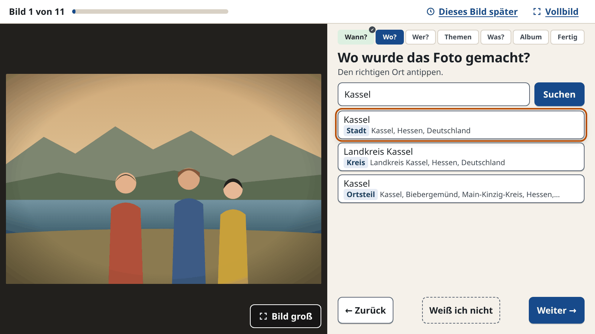

Der Ort wird zusätzlich als Tag `Kontinent/Land/Ort` gespeichert, z. B. `Europa/Deutschland/Kassel` (bei einem Land
nur `Europa/Deutschland`). Zusätze wie „Landkreis“, „Kreis“ oder „Regierungsbezirk“ fallen weg, Stadt und Landkreis
Kassel bekommen also beide `…/Kassel`. Der Kontinent ergibt sich aus dem Ländercode nach der UN-Einteilung;
Mittelamerika und Karibik zählen zu Nordamerika, Zypern und Russland zu Europa, die Türkei zu Asien.
Orts-Tags erscheinen nicht in der Themenliste.

### Wer?

Jedes Gesicht, das Immich erkannt hat, kommt einzeln. Es ist im Dia orange umrandet und neben der Frage vergrößert.

<p>
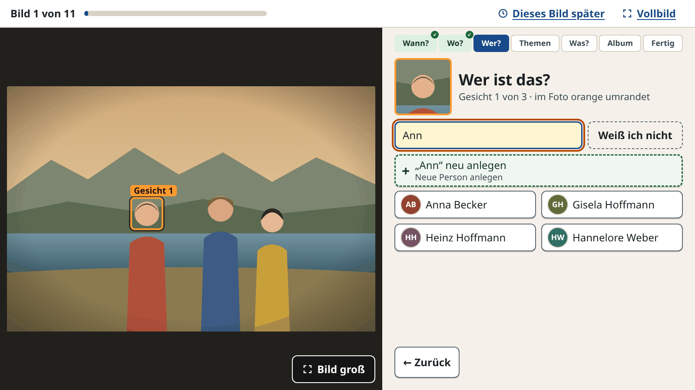

</p>

- **Gesicht ohne Namen (links):** Person antippen oder Namen eintippen. Gibt es den Namen noch nicht, legt
  **„+ „…“ neu anlegen“** die Person an.
- **Gesicht, dem Immich schon jemanden zugeordnet hat (rechts):** **„Ja, das ist …“**, **„Nein, jemand anderes“**
  (dann kommt die Liste) oder „Weiß ich nicht“. „Ja“ und „Weiß ich nicht“ lassen die Zuordnung in Immich, wie sie ist.
- Jede Antwort springt gleich zum nächsten Gesicht. Wer schon an einem anderen Gesicht hängt, steht nicht in der Liste.

Danach (oder wenn kein Gesicht erkannt wurde) kommen **weitere Personen**, deren Gesicht nicht umrandet war,
z. B. weil sie mit dem Rücken zur Kamera stehen. Mehrere sind möglich; neue Personen werden über das Suchfeld
angelegt. Der Knopf rechts unten zeigt „Niemand sonst →“ oder „Weiter (2 gewählt) →“.

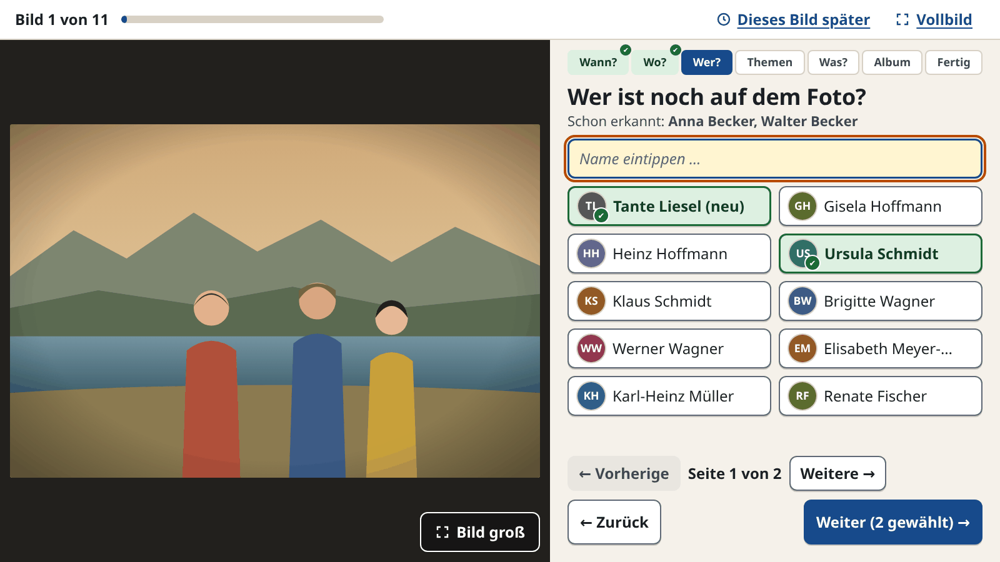

### Themen

Themen antippen, mehrere sind möglich. Die Auswahl steht oben (✕ entfernt ein Thema). Themen mit Unterthemen
haben rechts einen Teil wie „4 ›“, der die Unterthemen öffnet; die Pfadleiste („Alle Themen › Familie“) führt zurück.
Das Suchfeld findet Themen aus allen Ebenen.

<p>
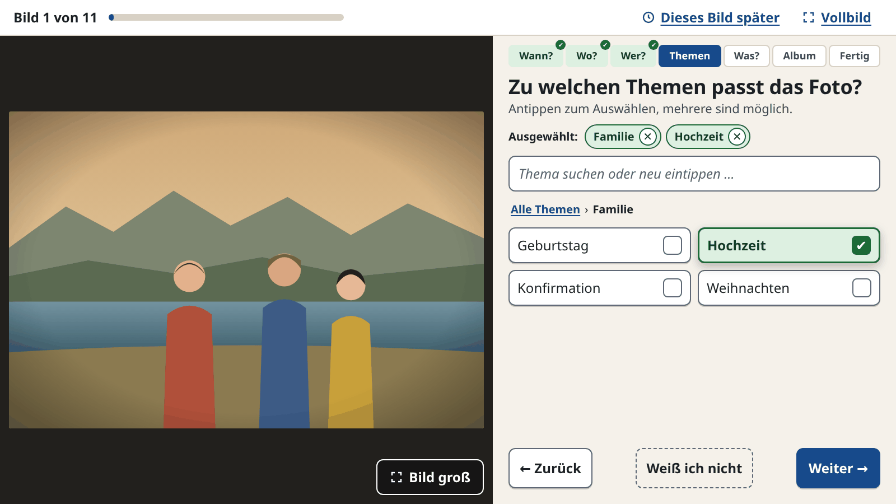
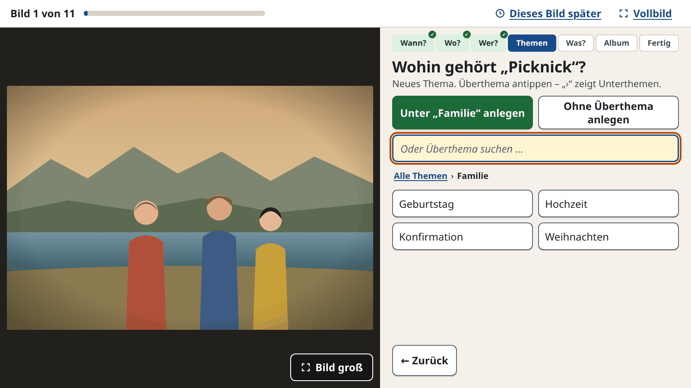
</p>

Gibt es ein Thema noch nicht, steht beim Eintippen oben **„+ „…“ neu anlegen“**. Danach fragt der Assistent
**„Wohin gehört …?“**: unter dem gerade geöffneten Thema, ohne Überthema, oder ein Überthema antippen bzw. suchen.

### Was?

Ein paar Worte zum Bild in ein Textfeld. Eine vorhandene Beschreibung wird oben angezeigt; der neue Text wird angehängt.

### Album

Alben antippen, mehrere sind möglich. Alben, in denen das Foto schon ist, sind grau mit „schon drin“ markiert.
Gibt es das gesuchte Album nicht, legt **„+ „…“ neu anlegen“** es an.

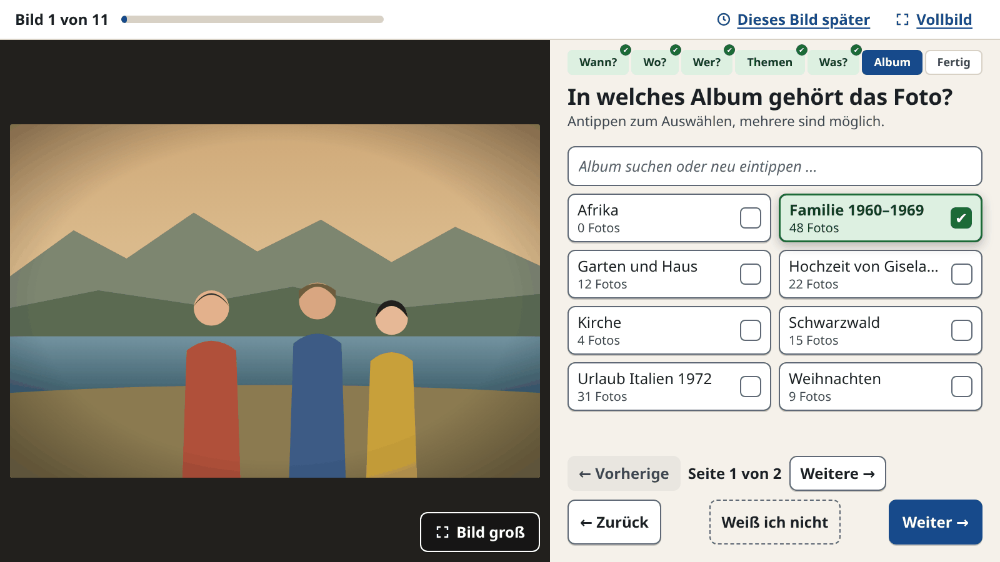

### Fertig

Die Zusammenfassung zeigt alle Antworten. **„Ändern“** neben jeder Zeile springt zur Frage. **„Speichern ✔“**
schreibt alles nach Immich und öffnet das nächste Bild. Klappt das Speichern nicht, bleiben alle Angaben stehen,
und „Noch einmal versuchen“ erscheint.

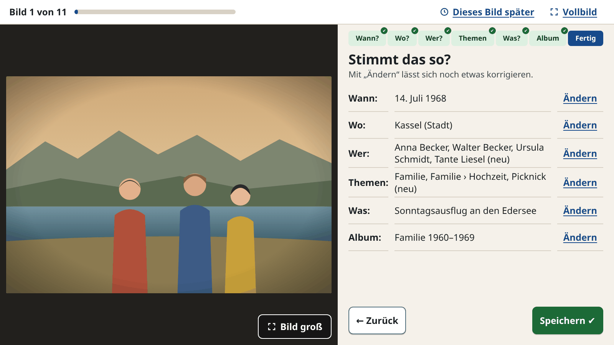

Am Ende zeigt „Geschafft!“, wie viele Bilder gespeichert wurden. **„Aufgehobene Bilder jetzt ansehen“** holt
die mit „Dieses Bild später“ übersprungenen Bilder sofort zurück.

### Fragen einstellen

Auf der Startseite (und am Ende) führt **„Fragen einstellen“** zur Liste der sechs Fragen. Antippen schaltet eine
Frage ein oder aus, ↑ und ↓ ändern die Reihenfolge; mindestens eine Frage bleibt eingeschaltet. Die Einstellung gilt
für alle Bilder und steht in `ablauf.json` im Programmordner (bleibt bei Updates erhalten). Ausgeblendete Fragen
ändern in Immich nichts. Wurde der Ablauf schon einmal gespeichert, stehen neu hinzugekommene Fragen
(z. B. „Album“) ausgeschaltet am Ende und müssen einmal eingeschaltet werden.

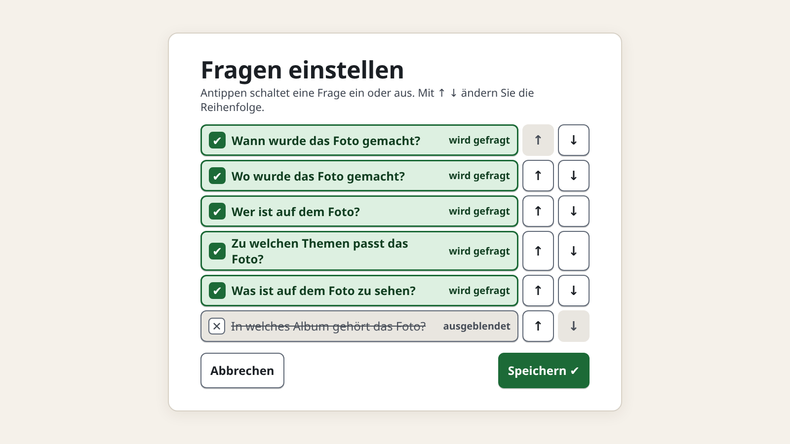

### Bedienhinweise

- **Tastatur:** Tab wechselt zwischen Knöpfen (orange umrandet), Enter löst aus, Esc geht zurück. Steht Text in
  einem Suchfeld, leert Esc zuerst das Feld.
- **Lange Namen** werden gekürzt und beim Drüberfahren mit der Maus vollständig angezeigt. Ohne Maus (Touch)
  stehen sie immer ganz da.
- **Kleine Bildschirme:** Unter 700 Bildpunkten Höhe wird alles etwas kompakter, unter 900 Bildpunkten Breite
  steht das Foto oben. Listen blättern seitenweise („← Vorherige · Seite 1 von 3 · Weitere →“), je nachdem, wie viel Platz ist.
- **Angefangene Bilder** werden im Browser gesichert. Nach einem Neustart geht es beim selben Bild weiter.

---

## Was genau gespeichert wird

| Eingabe | Wirkung in Immich |
|---|---|
| nur Jahr | Datum = **1. Juli** des Jahres, 12:00 Uhr |
| Jahr + Monat | Datum = **15.** des Monats, 12:00 Uhr |
| vollständiges Datum | dieser Tag, 12:00 Uhr |
| „Nur ungefähr“ | zusätzlich Tag `Datum-ungefähr` |
| Ort | Breiten- und Längengrad. Stadt und Land ergänzt Immich daraus selbst (siehe [Technische Details](#technische-details)) |
| Beschreibung | wird an eine vorhandene Beschreibung **angehängt** |
| Erkanntes Gesicht benannt | das Gesicht wird der Person zugeordnet (`PUT /faces/{personId}`), neue Namen werden vorher als Person angelegt |
| „Ja, das ist …“ / „Weiß ich nicht“ bei zugeordnetem Gesicht | nichts, die Zuordnung bleibt |
| „Nein, jemand anderes“ | das Gesicht wird der neu gewählten Person zugeordnet |
| Weitere Personen | manuelles Gesicht mit Rahmen über das **ganze Bild** (siehe [Grenzen](#bekannte-grenzen)) |
| Themen | Tags am Bild. Neue Themen werden erst beim Speichern angelegt, samt fehlender Oberthemen |
| Album | Bild wird ins Album gelegt (`PUT /albums/{id}/assets`). Neue Alben entstehen erst beim Speichern (`POST /albums`); gibt es den Namen schon, wird das vorhandene Album genommen |
| immer | Tag `Dia-bearbeitet`, danach wird `Dia-Nachpflege` entfernt |

12:00 Uhr verhindert, dass das Datum durch Zeitzonen-Umrechnung auf den Nachbartag rutscht.

Der Arbeits-Tag `Dia-Nachpflege` wird **erst ganz zum Schluss** entfernt. Bricht die Verbindung mittendrin ab,
bleiben die Eingaben erhalten, und „Noch einmal versuchen“ speichert erneut, ohne etwas doppelt anzulegen.

---

## Update und Fehlersuche

**Update:**

```bash
cd ~/dia-assistent
git pull && ./install.sh
```

Die `.env` bleibt erhalten. Läuft der Assistent während des Updates noch, erkennt der nächste Doppelklick den
veralteten Programmstand, beendet ihn und startet die neue Version.

**Fehlersuche:** Die Oberfläche zeigt nur kurze deutsche Meldungen. Steht dort „Da ist etwas schiefgegangen (Code …)“,
findet sich die Ursache in `dia-assistent.log` im Programmordner. Der API-Schlüssel wird dort nicht protokolliert.

| Meldung | Häufige Ursache |
|---|---|
| „Keine Verbindung zum Server“ | Internet weg oder `IMMICH_URL` falsch |
| „Der Zugangsschlüssel stimmt nicht“ | `IMMICH_API_KEY` falsch oder gelöscht |
| „Für diese Aktion fehlt die Berechtigung“ | dem API-Schlüssel fehlt ein Recht aus der Tabelle oben |
| „Die Markierung „Dia-Nachpflege“ gibt es in Immich nicht“ | Tag noch nicht angelegt oder anderer Name in `TAG_NAME` |

---

## Bekannte Grenzen

- **Personen ohne erkanntes Gesicht:** Die Immich-API kennt kein „Person X ist auf Bild Y“. Für Personen,
  deren Gesicht Immich nicht gefunden hat, legt der Assistent über `POST /faces` ein manuelles Gesicht an,
  dessen Rahmen das **ganze Bild** umfasst. Das Bild erscheint dann bei der Person, aber Immich lernt daraus
  nichts: Für manuelle Gesichter berechnet Immich keinen Gesichtsabdruck, die Person wird auf anderen Bildern
  also nicht wiedererkannt. Damit Immich eine neue Person lernt, sollte sie über ein erkanntes Gesicht angelegt werden.
- **Erkannte Gesichter:** Benannt wird nur das einzelne Gesicht. Gehört es in Immich zu einer unbenannten
  Gesichtsgruppe, bleiben die übrigen Gesichter dieser Gruppe unberührt.
- **Ort löschen** geht nicht: In Immich v3.3.1 akzeptiert `PUT /assets/{id}` für `latitude`/`longitude` nur Zahlen,
  kein Leeren (`server/src/dtos/asset.dto.ts`). „Weiß ich nicht“ bei „Wo?“ ändert deshalb nichts in Immich.
- **Themen und Alben** werden nur hinzugefügt, nie entfernt.
- **Diktieren** gibt es nicht: Firefox unterstützt die Web-Speech-API nicht, und Chrome schickt die Sprache an Google.
- **Testabdeckung:** Das Programm ist mit einer echten Immich-Instanz (v3.3.1) im Einsatz, aber nicht systematisch
  dagegen getestet. Automatisch geprüft wird gegen eine gemockte API. Bewusst nicht verifiziert sind:
  - [ ] Suche über `filter.tagIds` bei archivierten Bildern
  - [ ] Darstellung des Ganzbild-Gesichts in Personen- und Gesichtsansicht
  - [ ] Benennen erkannter Gesichter und Anlegen neuer Personen gegen ein echtes Immich
  - [ ] Automatisches Ergänzen von Stadt und Land nach dem Setzen der Koordinaten
  - [ ] Anlegen verschachtelter neuer Themen per `PUT /tags`
  - [ ] Firefox (die Oberfläche wurde nur in Chromium geprüft)

---

## Technische Details

**Stack:** Python ≥ 3.10, FastAPI, uvicorn, httpx. Oberfläche als schlichtes HTML/CSS/JS ohne Build-Schritt.

```
dia_assistent/
  __main__.py   Start: Server auf 127.0.0.1, Browser öffnen, veralteten Server ersetzen
  app.py        lokale HTTP-Schnittstelle für die Oberfläche
  immich.py     Immich-Client und Speicherablauf
  logic.py      Datumslogik, Beschreibung, Tag-Pfade (ohne Netzwerk)
  geocode.py    Nominatim mit 1 Anfrage/s und Zwischenspeicher
  config.py     .env lesen
  static/       Oberfläche
```

<details>
<summary><b>Verwendete Immich-Endpunkte</b></summary>

Ermittelt aus der OpenAPI-Spezifikation (`x-immich-permission`) und dem Server-Quellcode von v3.3.1.

| Zweck | Endpunkt |
|---|---|
| Bilder mit Arbeits-Tag finden | `POST /search/metadata` mit `{"filter": {"tagIds": {"any": [<id>]}}}`, Blättern über `nextCursor` |
| Bilddaten / Vorschau | `GET /assets/{id}`, `GET /assets/{id}/thumbnail?size=preview` |
| Orts-Tag | wie Tags: `PUT /tags` mit `Kontinent/Land/Ort` |
| Datum, Ort, Beschreibung | `PUT /assets/{id}` (`dateTimeOriginal`, `latitude`, `longitude`, `description`) |
| Tags lesen / anlegen | `GET /tags`, `PUT /tags` (Upsert mit vollen Pfaden wie `Urlaub/Italien/Venedig`) |
| Tags setzen / entfernen | `PUT` / `DELETE /tags/{id}/assets` |
| Personen | `GET /people`, `GET /people/{id}/thumbnail` |
| Gesichter | `GET /faces?id=…`, `POST /faces`, `PUT /faces/{personId}` mit `{"id": <Gesicht>}` |
| Neue Person | `POST /people` |
| Alben | `GET /albums` (mit `assetId`: Alben des Bildes), `POST /albums`, `PUT /albums/{id}/assets` |

Die Felder `tagIds` und `page` auf oberster Ebene von `/search/metadata` sind seit v3.2.0 veraltet und werden nicht
verwendet. Immich prüft die Rechte eines API-Schlüssels pro Endpunkt, innerhalb der Dienste nur noch die
Eigentümerschaft.

</details>

<details>
<summary><b>Stadt und Land nach dem Setzen der Koordinaten</b></summary>

Laut Quellcode (v3.3.1) ergänzt Immich Stadt, Bundesland und Land automatisch, sofern die Ortsbestimmung
(Reverse-Geocoding) in den Server-Einstellungen aktiv ist (Standard):

1. `PUT /assets/{id}` speichert die Koordinaten und reiht den Job `SidecarWrite` ein (`server/src/services/asset.service.ts`).
2. Nach `SidecarWrite` reiht `JobService` den Job `AssetExtractMetadata` ein (`server/src/services/job.service.ts`).
3. `AssetExtractMetadata` ruft `mapRepository.reverseGeocode` auf (`server/src/services/metadata.service.ts`).

Das passiert asynchron und kann einige Sekunden dauern.

</details>

<details>
<summary><b>Wiederholbares Speichern und Entwürfe</b></summary>

- Jeder Speicherschritt ist wiederholbar: Eine Beschreibung, die schon am Ende steht, wird nicht noch einmal angehängt.
  Personen, die schon zugeordnet sind, bekommen kein zweites Gesicht. Eine neue Person wird nur angelegt, wenn
  es noch keine sichtbare Person mit diesem Namen gibt. „Schon getaggt“ gilt nicht als Fehler.
- Das angefangene Bild wird als Entwurf im Browser (`localStorage`) gesichert und nach einem Neustart fortgesetzt.
- Der Starter vergleicht eine Prüfsumme des Programmcodes mit dem laufenden Server und ersetzt ihn bei Abweichung.

</details>

---

## Entwicklung

```bash
python3 -m venv .venv
.venv/bin/pip install -r requirements-dev.txt
.venv/bin/python -m pytest -q
.venv/bin/python -m dia_assistent --no-browser   # Server starten, ohne den Browser zu öffnen
```

GitHub Actions führt die Tests bei jedem Push unter Python 3.10 und 3.12 aus.

### Release

1. Version in `dia_assistent/__init__.py` erhöhen und committen.
2. Release mit passendem Tag anlegen, z. B. `v0.3.0`, `0.3.0` oder kurz `0.3` (entspricht `0.3.0`).
   Das geht auf GitHub über *Releases → Draft a new release* oder per Terminal:
   `git tag v0.3.0 && git push origin v0.3.0`.
3. Der Release-Workflow führt die Tests aus, prüft, ob Tag und `__version__` zusammenpassen, und hängt
   `dia-assistent-<tag>.tar.gz` samt SHA-256-Prüfsumme an das Release.

---

## Lizenz

Copyright (C) 2026 [John-Goodenough](https://github.com/John-Goodenough)

Dieses Programm ist freie Software: Du kannst es unter den Bedingungen der **GNU General Public License,
Version 3** (oder nach deiner Wahl jeder späteren Version), wie von der Free Software Foundation veröffentlicht,
weitergeben und/oder verändern. Veränderte Versionen müssen ebenfalls unter der GPL stehen.

Das Programm wird in der Hoffnung verbreitet, dass es nützlich ist, aber **ohne jede Gewährleistung**,
sogar ohne die implizite Gewährleistung der Marktgängigkeit oder der Eignung für einen bestimmten Zweck.
Den vollständigen Lizenztext enthält die Datei [`LICENSE`](LICENSE).
